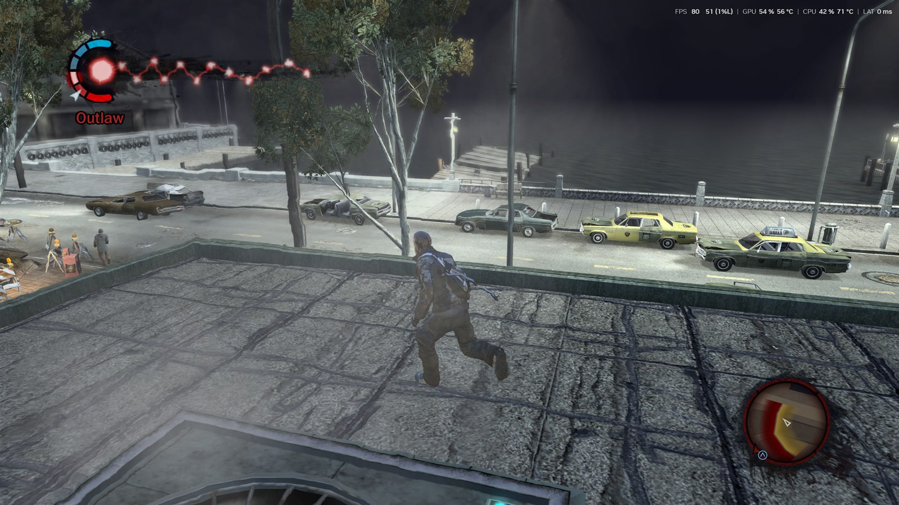
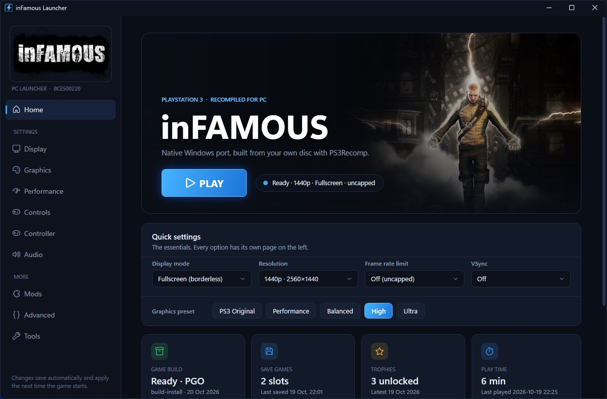
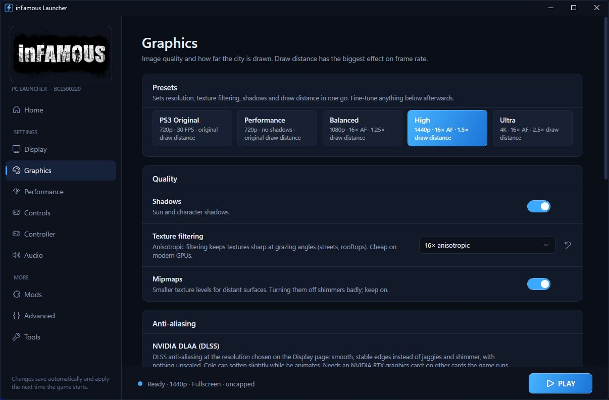
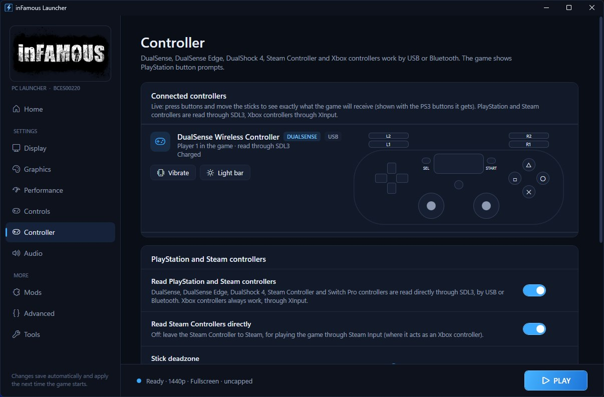
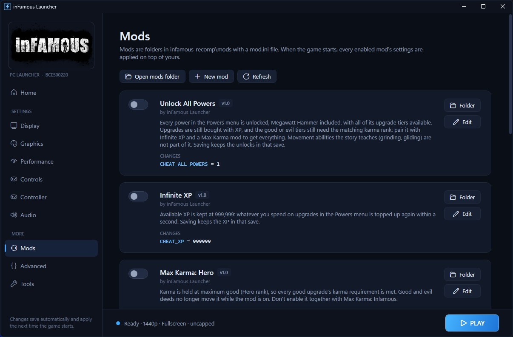
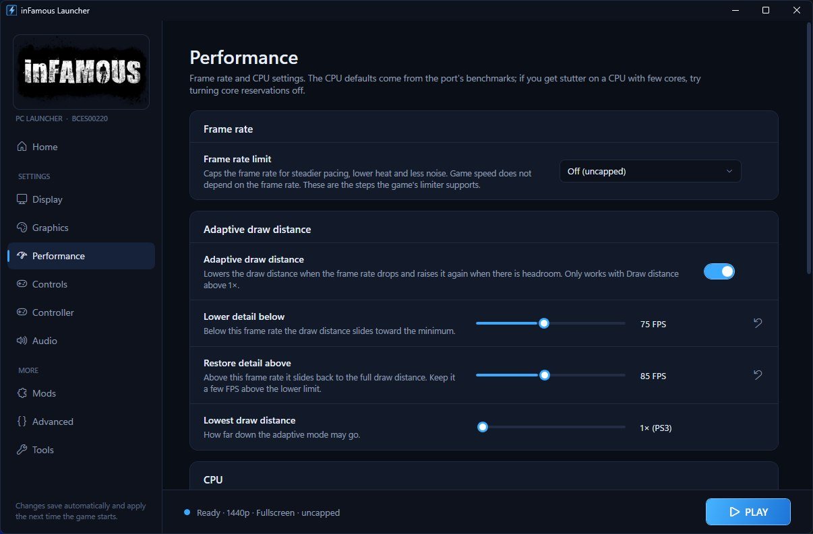
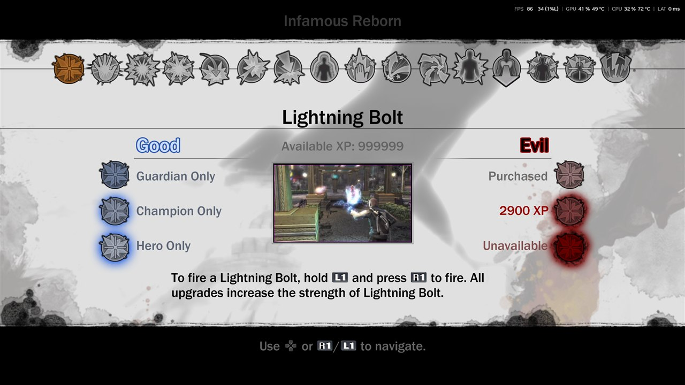
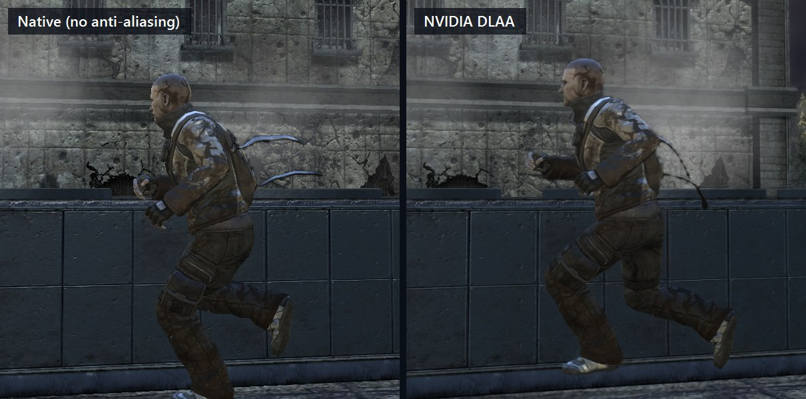
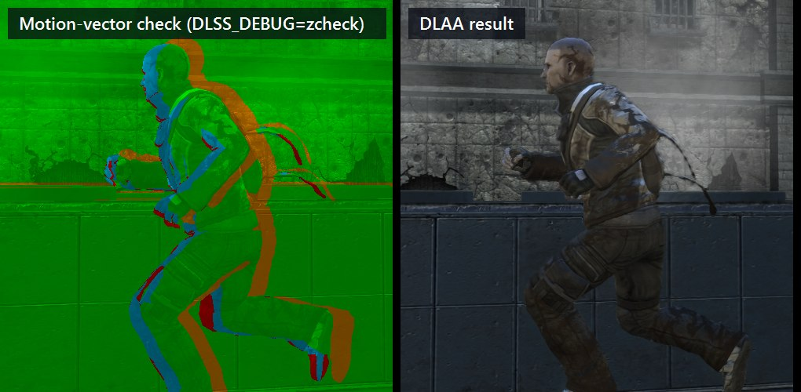

# inFamous PC — Enhanced

**An enhanced fork of [whompay/inFAMOUSreborn](https://github.com/whompay/inFAMOUSreborn), the native Windows port of *inFamous* (PlayStation 3, 2009).**

It adds:
- a full launcher with every setting in one place;
- **NVIDIA DLSS (DLAA)**, wired into the port's own Direct3D 12 renderer;
- optional **DLSS 5 Neural Rendering**;
- native **DualSense, DualShock 4 and Steam Controller** support;
- **cheat mods**;
- a tuned, benchmarked default setup.



> [!IMPORTANT]
> **This repository contains no game files.** It has no game code, no game data and nothing generated from a game. You build the game yourself, on your own PC, from **your own** disc dump of the European release (`BCES00220`). The port regenerates the recompiled code from your copy at install time.

---

## Contents

- [What this fork adds](#what-this-fork-adds)
- [Screenshots](#screenshots)
- [Installing](#installing)
- [The launcher](#the-launcher)
- [NVIDIA DLSS / DLAA](#nvidia-dlss--dlaa)
- [Controllers](#controllers)
- [Mods and cheats](#mods-and-cheats)
- [Performance and how it's optimised](#performance-and-how-its-optimised)
- [Updating](#updating)
- [Project layout](#project-layout)
- [Credits and legal](#credits-and-legal)

---

## What this fork adds

| | Feature | What it does |
|---|---|---|
| 🚀 | **inFamous Launcher** | A WPF settings app and launcher: display, graphics, performance, controls, controller, audio, mods, saves and tools. Graphics presets, a live controller tester, save backups and play-time tracking |
| ✨ | **NVIDIA DLAA (DLSS)** | DLSS anti-aliasing at native resolution, integrated straight into the renderer: sub-pixel jitter, a depth snapshot and camera motion vectors reconstructed from the game's own constants. Models K (DLSS 4) and **L / M (DLSS 4.5)** |
| 🧠 | **DLSS 5 Neural Rendering** *(optional)* | One switch installs [OptiScaler](https://github.com/optiscaler/OptiScaler)-DLSSNR beside the game so NVIDIA's DLSS 5 model runs on top of DLAA. Bring your own files (see below) |
| 🎮 | **PlayStation and Steam controllers** | DualSense, DualSense Edge, DualShock 4, Steam Controller and Switch Pro, by USB or Bluetooth, through SDL3. Includes rumble, a light bar that can follow Cole's karma, a touchpad mapping and battery display |
| 🧪 | **Cheat mods** | Infinite XP, Max Karma (Hero or Infamous) and Unlock All Powers, as launcher mods you switch on and off |
| ⚙️ | **Benchmarked defaults** | CPU-core placement, resolution and draw distance tuned with scripted, repeatable benchmark runs |
| 🔁 | **Survives upstream updates** | `launcher\dlss\apply-dlss.cmd` re-applies every patch after an upstream update and rebuilds. It only adds hooks that are missing, and backs out if a build fails |

## Screenshots

<table>
  <tr>
    <td><br/><sub><b>Home</b>: play, quick settings, build, saves, trophies and play time</sub></td>
    <td><br/><sub><b>Graphics</b>: presets, texture filtering, DLAA and the DLSS model, draw distance</sub></td>
  </tr>
  <tr>
    <td><br/><sub><b>Controller</b>: detected pads, live input view, battery, rumble and light bar tests</sub></td>
    <td><br/><sub><b>Mods</b>: cheat mods and your own mods, one switch each</sub></td>
  </tr>
  <tr>
    <td><br/><sub><b>Performance</b>: frame cap, adaptive draw distance, CPU core placement</sub></td>
    <td><br/><sub><b>In game</b>: Infinite XP + Unlock All Powers + Max Karma in the Powers menu</sub></td>
  </tr>
</table>



---

## Installing

### What you need

- **Your own inFamous disc dump**, European release (`BCES00220`): an `.iso` (with its `.dkey` if it's encrypted) or the game folder that contains `PS3_GAME`.
- **Windows 10 or 11**, 64-bit, and a Direct3D 12 GPU. DLSS needs an NVIDIA RTX card; DLSS 5 needs an RTX 50 series card.
- [**Python 3.10+**](https://www.python.org/downloads/), with "Add python.exe to PATH" ticked.
- [**Visual Studio 2022 Build Tools**](https://visualstudio.microsoft.com/downloads/) with *Desktop development with C++* and the *C++ Clang Compiler for Windows* component.
- [**RPCS3**](https://rpcs3.net), only if your dump has `EBOOT.BIN` but no decrypted `EBOOT.elf`. It's used only to decrypt the executable.
- About 10 GB of free disk space and 16 GB of RAM.

### Easy install (recommended)

1. **Install the base port.** Download **inFamous Setup.exe** from the [upstream releases](https://github.com/whompay/inFAMOUSreborn/releases), run it and pick your dump. It checks the requirements, copies the game out of your disc image, regenerates the code from your copy and builds it.
2. **Optional, for DLSS:** download the [NVIDIA DLSS SDK](https://github.com/NVIDIA/DLSS/releases) (v310.9.16 or newer) and extract it to a `dlss-sdk` folder inside the install folder, so `dlss-sdk\include\nvsdk_ngx.h` exists. Do this *before* step 4; without it, everything else still works.
3. **Point the install at this fork.** In the install folder, open `installer\infamous.toml` and set:
   ```toml
   [update]
   repo = "ibrahimpuri/inFamous-PC-Enhanced"
   ```
4. **Update.** Run **Update inFamous** (the Start-menu shortcut, or `Update inFamous.cmd`). The updater downloads only the files that differ from this fork, then rebuilds just what changed.
5. **Build the launcher:** run `launcher\build.cmd`. It writes `inFamous Launcher.exe` into the install folder, using the C# compiler from the Build Tools you already have.

### From source

```bat
git clone https://github.com/ibrahimpuri/inFamous-PC-Enhanced.git
cd inFamous-PC-Enhanced\installer
cargo build --release
target\release\infamous-installer --game "D:\Dumps\inFamous"
cd .. && launcher\build.cmd
```

`infamous-installer doctor` only checks the requirements. An interrupted install continues where it stopped. See [installer/README.md](installer/README.md) for every step.

---

## The launcher

`inFamous Launcher.exe` starts the game exactly the way `inFamous.exe` does, from `installer\launch.txt`, and layers your choices on top. It never edits `launch.txt`, so updates can't overwrite your settings, and deleting `launcher\launcher.ini` returns everything to the defaults.

| Page | What's there |
|---|---|
| **Home** | Big Play button, quick settings (display mode, resolution, frame cap, VSync), one-click graphics presets, and the status of the build, saves, trophies and play time |
| **Display** | The same settings as the in-game F10 menu: changing them in either place updates the other. It also suggests the resolution matching your monitor |
| **Graphics** | Presets (PS3 Original → Ultra), shadows, anisotropic filtering, NVIDIA DLAA with the DLSS model, DLSS 5 Neural Rendering, and draw distance for the city, objects and vehicles |
| **Performance** | Frame cap, adaptive draw distance (drops detail below a target frame rate and restores it above), CPU core placement for hybrid Intel CPUs, process priority |
| **Controls** | Keyboard and mouse: raw input, 1:1 camera turning, linear response, invert, speed |
| **Controller** | Every connected pad and how the game will read it, with a live view of what it sends, battery, vibration and light bar tests, plus deadzone, touchpad, rumble and light bar settings |
| **Audio** | Buffer size, dropout concealment, time-stretching during stalls, high-priority audio threads |
| **Mods** | Folders under `infamous-recomp\mods`, each a `mod.ini` with env overrides. Switch them on or off, or create a new one |
| **Advanced / Tools** | Every raw environment variable, one-click save backups (zip), update checks, the prerequisites doctor |

From the command line, `"inFamous Launcher.exe" --play` starts the game with your saved settings and no window. `--dry-run FILE` writes exactly what would run (exe, arguments, environment) without starting anything.

See [launcher/README.md](launcher/README.md) for the details.

---

## NVIDIA DLSS / DLAA



inFamous never had temporal anti-aliasing, so this fork builds everything DLSS needs inside the port's Direct3D 12 backend ([`rsx_dlss.cpp`](ps3recomp/libs/video/rsx_dlss.cpp)):

- **Jitter:** every draw of the main 3D scene gets a sub-pixel Halton(2,3) jitter in its vertex epilogue. HUD draws are left alone.
- **Camera:** inFamous renders camera-relative. The projection × rotation is recovered as the per-frame mode of vertex constants `c263..c266`. The camera's movement is the consensus of how static objects' camera-relative positions changed; typically 250+ objects agree within 0.5 cm.
- **Depth:** a snapshot of the scene depth is taken right after the last scene draw, because the HUD clears it afterwards.
- **Motion vectors:** each pixel is reprojected into the previous frame. A depth-consistency check catches what the camera can't explain. Where an object moves with the camera, as Cole does while you run, the pixel gets zero motion. Newly uncovered pixels keep the camera vector.
- **HUD:** DLSS runs on the scene right after the post-processing composite. The HUD is then put back pixel-exact, so it is never smeared.

Pick the model on the Graphics page: **K** (DLSS 4) or **L / M** (DLSS 4.5). The `DLSS_DEBUG=mv|depth|zcheck` modes visualise the inputs; the image above is `zcheck`.

**DLSS 5 Neural Rendering** is optional. NVIDIA ships no public integration for it, so it goes through *OptiScaler-DLSSNR*, a community build of OptiScaler.
- **Bring your own files:** you supply the package and NVIDIA's `nvngx_dlssnr.dll` model yourself. Extract them into `launcher\dlss5\`; neither is redistributable, so neither is in this repo.
- **Switching it on:** turn on *Graphics → DLSS 5 Neural Rendering*. The launcher installs OptiScaler as `dxgi.dll` beside the game when you press Play, and removes it again when the switch is off.

See [launcher/dlss/README.md](launcher/dlss/README.md) for all switches and the limits.

## Controllers

| Controller | How it's read |
|---|---|
| DualSense, DualSense Edge, DualShock 4 (USB / Bluetooth) | Directly through [SDL3](https://github.com/libsdl-org/SDL) ([`pad_sdl3.c`](ps3recomp/libs/input/pad_sdl3.c)), loaded at run time |
| Steam Controller | Directly through SDL3, or through Steam Input (as an Xbox pad) when you play from Steam |
| Xbox and other XInput pads, Steam Input's virtual pads | XInput, as in the base port |

- **Button mapping:**
  - Face buttons are positional, so Cross is the bottom button.
  - Create/Share and the touchpad click are SELECT; Options is START.
  - Back paddles and grips are L3/R3.
- **Prompts:** the game shows its PS3 button prompts.
- **Light bar:** can follow your karma, blue for good and red for evil.
- **Hot-plug:** a pad connected mid-game is picked up within half a second.
- **SDL3:** 3.4.18 (zlib licence) is included in `sdl3\`. If `SDL3.dll` is missing, the game falls back to XInput.

## Mods and cheats

Mods are folders in `infamous-recomp\mods\` with a `mod.ini`:

```ini
[mod]
name=Infinite XP
description=Available XP is kept at 999,999.

[env]
CHEAT_XP=999999
```

| Included mod | Effect |
|---|---|
| **Infinite XP** | Available XP stays at 999,999. What you spend in the Powers menu is topped up within a second |
| **Max Karma: Hero / Infamous** | Karma is held at maximum good or evil, so that side's upgrade ranks are met |
| **Unlock All Powers** | All 16 powers in the Powers menu, Megawatt Hammer included, with every upgrade tier available |
| **Less Traffic Pop-in** | Traffic spawns only outside a wider view cone, so fewer cars appear out of nowhere |

The cheats ([`infamous_cheats.h`](infamous-recomp/infamous_cheats.h)) write to the game's hero-progress object: a static object at `0x007D5F80` holding karma, XP and the per-power unlock levels. It was found by scanning live memory for a save's values and checked in the Powers menu.
- **Saves:** saving with a cheat on keeps its effect in that save.
- **Karma:** the karma mods freeze karma while they're on.

---

## Performance and how it's optimised

The defaults were chosen from **scripted, repeatable benchmark runs**:
- **Same route every time:** the same save, and a fixed input script that drives the menus and the camera through the `PAD_FILE` bench hook.
- **Telemetry:** frame times from the port's `PS3_TELEM` output, reported as 1 % lows and frames over 25 ms.
- **Comparisons:** in-run A/B switching (`PS3_AB` / `PS3_ABX_SEQ`) where possible.
- **Saves:** backed up before every run and restored after.

**Test PC:** Intel Core Ultra 7 (8 P-cores + 16 E-cores), GeForce RTX 5070 Ti, 1440p 240 Hz VRR display.

| Test | Result |
|---|---|
| **CPU placement as shipped** (busy threads on P-cores, a reserved core for the main thread and the GPU command thread) | **123.7 FPS** average, **89 FPS** 1 % low (draw distance 2×) |
| Same, without the P-core preference | Same average, 1 % lows down to ~61 FPS, about 15× more frames over 25 ms |
| **1440p native** (`RES_SCALE 2`) | **125.4 FPS** / 73 FPS 1 % low, GPU about 21 % busy |
| 4K supersampled (`RES_SCALE 3`) | 114.0 FPS / 63 FPS 1 % low, GPU about 32 % busy (kept 1440p) |
| **DLAA on** (1440p, models K / L / M) | No measurable FPS change: the game is CPU-bound and the render thread idles about 7 ms per frame |

The resolution runs were separate runs rather than in-run A/B, so treat those numbers as indicative.

What the tuned profile sets:
- **Process priority:** above normal.
- **Display:** variable refresh with tearing allowed, for G-Sync / FreeSync displays.
- **Draw distance:** 2×.
- **Adaptive draw distance:** lowers detail below 75 FPS and restores it above 85.

On a slower CPU, the launcher's **Performance** presets and the adaptive draw distance do the same balancing for you. The port itself is a profile-guided-optimised (PGO) clang build. The launcher's Home page shows *Ready · PGO* when that's in place.

---

## Updating

- **Players of this fork:** use **Update inFamous** once your install points at this repository (step 3 above).
- **Upstream changes** reach this fork through GitHub's **Sync fork** button.
- **Installs that track upstream (whompay/inFAMOUSreborn):** after each upstream update, run `launcher\dlss\apply-dlss.cmd` to put DLSS, the cheats and the controller support back. Each hook is placed next to a line that must appear exactly once.
  - If an update changed one of those lines, nothing is written, and you're told which patch needs porting by hand.
  - If the build fails, the source is restored.

## Project layout

| Path | Contents |
|---|---|
| `ps3recomp/` | The recompiler toolkit and runtime (PPU/SPU lifters, HLE libraries, RSX on Direct3D 12). This fork adds `libs/video/rsx_dlss.*` and `libs/input/pad_sdl3.*` |
| `infamous-recomp/` | The inFamous-specific code. This fork adds `infamous_cheats.h` and `mods/` |
| `installer/` | Setup and the command-line installer. Reads your disc, regenerates the code from your game, applies the patches and builds |
| `launcher/` | The inFamous Launcher (C# / WPF, .NET Framework 4.8) and `launcher/dlss/`, the patch sources and the re-apply script |
| `sdl3/` | SDL 3.4.18 headers and `SDL3.dll` (x64), for the controller support |
| `docs/screenshots/` | The images in this README |

Not in the repository, by design:
- **Anything from the game:** dumps, `EBOOT`, the recompiled or lifted code, assets and saves.
- **Per-player files:** your `launcher.ini`.
- **Third-party files you download yourself:** the NVIDIA DLSS SDK and the DLSS 5 / OptiScaler package.

## Credits and legal

- **Base port:** [whompay/inFAMOUSreborn](https://github.com/whompay/inFAMOUSreborn), the inFamous PC port this fork builds on.
- **Recompiler:** [ps3recomp](https://github.com/sp00nznet/ps3recomp) by Ned Heller / sp00nznet and contributors (MIT; see [ps3recomp/LICENSE](ps3recomp/LICENSE)).
- **Libraries and tools:**
  - [SDL](https://github.com/libsdl-org/SDL) (zlib licence, `sdl3/LICENSE.txt`).
  - [NVIDIA DLSS](https://github.com/NVIDIA/DLSS) (you download the SDK under NVIDIA's licence).
  - [OptiScaler](https://github.com/optiscaler/OptiScaler) (optional, user-supplied).
  - [RPCS3](https://rpcs3.net), used only to decrypt the game executable.
- **Launcher, DLSS integration, controller support and cheat mods:** this fork.
- **The game:** *inFamous* © Sony Interactive Entertainment, developed by Sucker Punch Productions.

This is an unofficial fan project, not affiliated with or endorsed by Sony Interactive Entertainment, Sucker Punch Productions, NVIDIA or Valve. It distributes no game content: you need your own legally obtained copy of the game.
